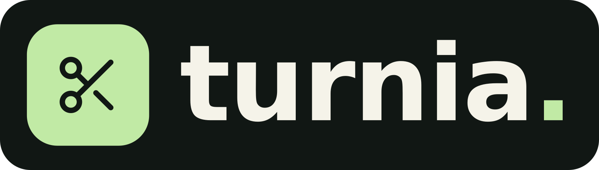
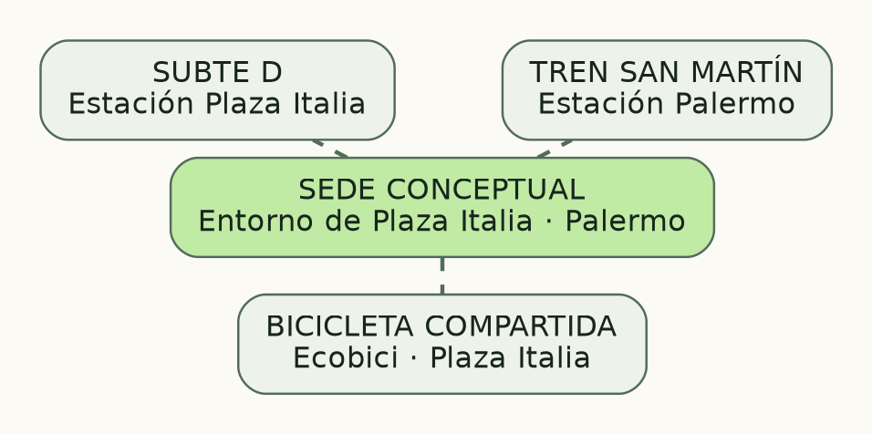
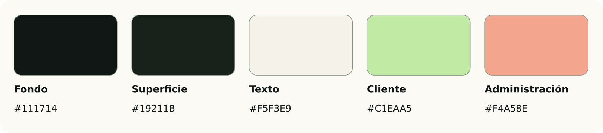
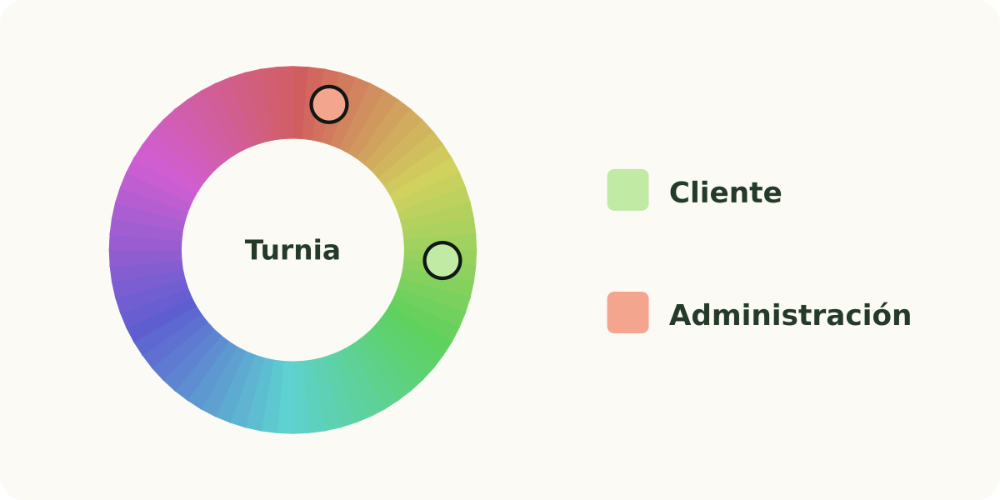
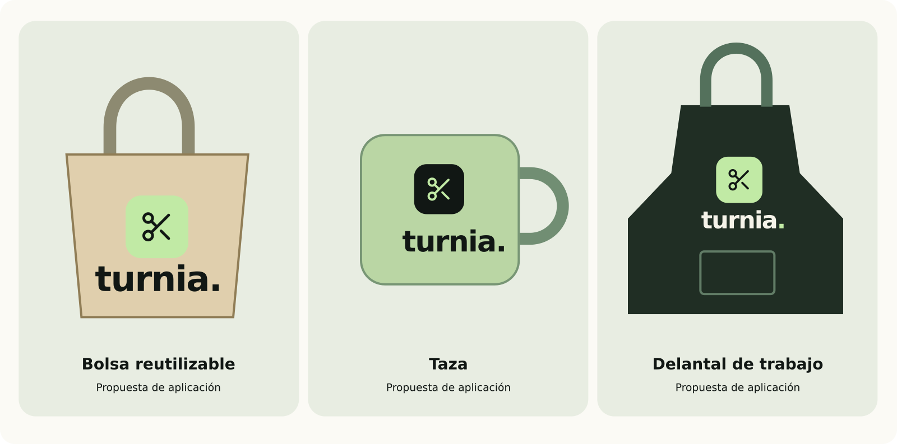
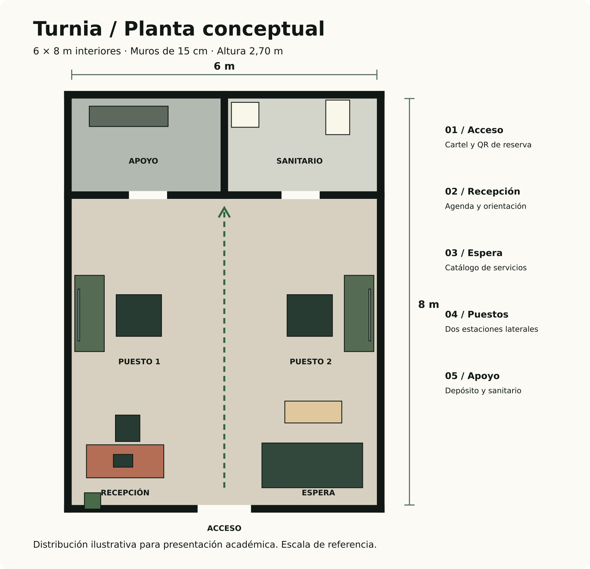
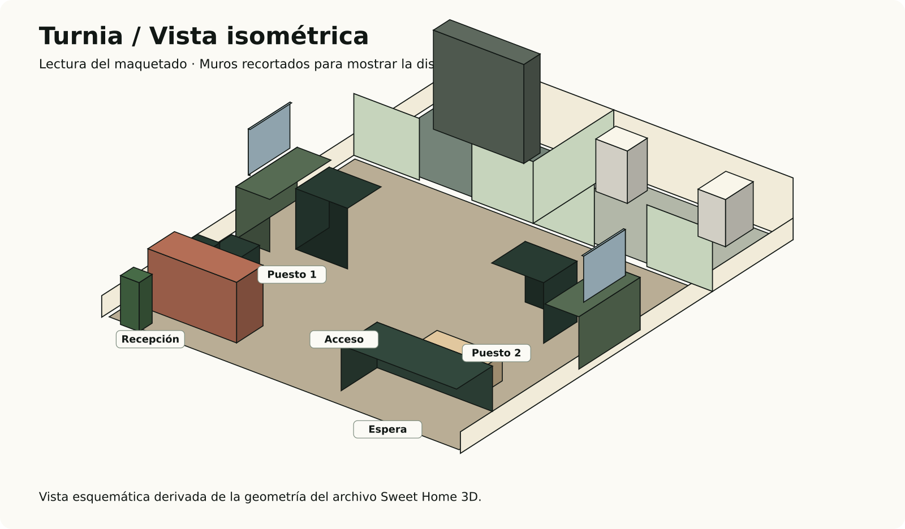

# 10. Sector de marketing e identidad institucional

## 10.1 Identidad general de la empresa

Turnia es la marca del proyecto académico de gestión de turnos para barberías. Su propósito es facilitar la reserva y ayudar al personal a operar desde una agenda compartida. La identidad tiene una voz directa y cercana, con verbos de acción y voseo. La firma combina tijeras y el nombre en minúsculas. No se incluyen datos registrales, fiscales ni de contacto comercial.

{width=53%}

## 10.2 Lugar físico de la empresa

La sede es una **propuesta conceptual** en el entorno de **Plaza Italia, Palermo, Ciudad Autónoma de Buenos Aires**. La zona se usa como referencia para simular el acceso, la atención, la espera y los puestos de una barbería. La propuesta no asigna dirección, domicilio comercial ni inmueble real.

## 10.3 Triangulación de medios de transporte y ubicación

{width=96%}

| Medio | Referencia de llegada | Revisión antes de usar una sede real |
|:--|:--|:--|
| Subte | Línea D, estación Plaza Italia. | Verificar la salida y el recorrido peatonal hasta el ingreso. |
| Tren | Línea San Martín, estación Palermo. | Verificar el enlace peatonal por el entorno de avenida Santa Fe. |
| Bicicleta compartida | Ecobici, estación Plaza Italia. | Consultar disponibilidad y recorrido ciclista el día de uso. |

Los puntos son referencias del entorno. El esquema no está a escala y no indica horarios de servicio. [Estaciones de Subte de la Ciudad](https://data.buenosaires.gob.ar/dataset/subte-estaciones/resource/juqdkmgo-1994-resource) · [Centro de Trasbordo Pacífico](https://buenosaires.gob.ar/gcaba_historico/centro-de-trasbordo-pacifico) · [Estación Ecobici Plaza Italia](https://buenosaires.gob.ar/visita-apostolica-del-santo-padre-leon-xiv/cronograma-de-ecobici)

## 10.4 Isotipo

Tijeras de trazo oscuro dentro de un cuadrado verde de esquinas redondeadas. Remite al rubro y replica el motivo que aparece en la app. Se usa en avatares, encabezados compactos e identificadores de sector. La pieza vectorial incorpora el motivo de tijeras de Lucide. [Lucide](https://lucide.dev/icons/scissors)

## 10.5 Logotipo

La palabra **turnia.** en minúsculas, con peso alto y punto verde. Puede aparecer sola en espacios horizontales o junto al isotipo en la firma principal. La entrega incluye las piezas vectoriales por separado y una variante monocroma.

## 10.6 Círculo cromático y paleta institucional

{width=95%}

{width=68%}

En el círculo cromático, el verde suave se asocia a la reserva y el coral cálido a la administración. El fondo verde oscuro y el marfil organizan el contraste en ambas áreas. El color comunica contexto junto con texto, etiquetas y estados explícitos. Se recomienda revisar el contraste y la legibilidad después de cambiar los colores o el tamaño de una pieza.

## 10.7 Productos

| Producto o función | Valor para la barbería |
|:--|:--|
| Turnia para clientes | Catálogo, horarios, reserva y código del turno. |
| Turnia para el personal | Agenda por fecha, confirmación y cancelación. |
| Gestión de catálogo | Alta, edición, pausa y reactivación de servicios. |
| Prioridad VIP | Opción con recargo informado antes de confirmar. |

El catálogo puede incluir corte, barba y otros servicios configurados por la organización. Las piezas presentan la reserva y la agenda sin anunciar pagos ni avisos automáticos.

## 10.8 Merchandising

{width=96%}

La bolsa y la taza funcionan como piezas de presentación. El delantal integra la identidad al uniforme del equipo. Los diseños se entregan como mockups editables en SVG. La fabricación y la selección de materiales quedan fuera de la propuesta.

## 10.9 Diversas aplicaciones del logo

| Aplicación | Variante y soporte |
|:--|:--|
| Cabecera y portada del tríptico | Firma horizontal con fondo oscuro. |
| Avatar y distintivo de sector | Isotipo con fondo verde y trazo oscuro. |
| Sello, bordado o reproducción a una tinta | Firma monocroma, con contraste según el soporte. |
| Recepción y espera | Firma horizontal, texto de acción y QR con margen blanco. |

## 10.10 Estudio de identidad visual

La identidad parte de tres escenas de uso. En el celular, el cliente busca un botón reconocible y estados claros. En recepción, el personal necesita distinguir acceso y agenda. En la presentación académica, una misma firma conecta app, folleto, plano y señalética. La coherencia se evaluó contra la paleta de la aplicación y se revisa con las piezas impresas al tamaño final. No se adjunta una encuesta de percepción ni métricas de campaña.

## 10.11 Manual de identidad / manual de usuario

**Manual de identidad.** Usar la firma a color sobre fondo oscuro y la monocroma en soportes de una tinta. Dejar un margen libre de al menos un cuarto del ancho del isotipo alrededor de la firma. Como referencias de reproducción, usar la firma desde 150 px en pantalla o 30 mm en impresión y el isotipo desde 24 px en pantalla. No estirar, reordenar ni superponer la firma sobre fondos con poco contraste. Usar una sans serif compatible y verificar legibilidad. Para impresión, revisar una prueba física por soporte.

El **Manual de usuario** se entrega aparte con instrucciones para clientes, profesionales y administración, y una guía para repetir la prueba móvil.

## 10.12 Tríptico informativo

Se incluye un tríptico A4 apaisado de dos caras y tres paneles por cara. Explica la reserva, la agenda y la disponibilidad compartida, e identifica la sede como conceptual. Para plegado, imprimir a tamaño real, en doble cara por el borde corto y verificar la alineación en una hoja de prueba. Los QR conservan el margen blanco requerido para lectura.

## 10.13 Códigos QR de los sectores

| Sector | Acción al escanear | Destino |
|:--|:--|:--|
| Acceso | Abrir el recorrido de reserva. | [Reserva](https://turnia-expo.independentbench4.chatgpt.site/reservar) |
| Recepción | Abrir el inicio de sesión del personal. | [Agenda](https://turnia-expo.independentbench4.chatgpt.site/admin/login) |
| Espera | Consultar el catálogo desde el inicio. | [Catálogo](https://turnia-expo.independentbench4.chatgpt.site/) |
| Ubicación de referencia | Consultar el mapa de la zona conceptual. | [Plaza Italia en el mapa](https://www.google.com/maps/search/?api=1&query=Plaza+Italia+Palermo+Buenos+Aires) |

Incluye PNG individuales y una lámina de señalética. Se verificó que los códigos decodifican a los destinos indicados. Los tres enlaces de Turnia corresponden al despliegue privado y requieren acceso autorizado. El código de recepción requiere además una cuenta de personal para consultar la agenda.

## 10.14 Maquetado físico — Sweet Home 3D

El archivo `Turnia_Local_Conceptual.sh3d` es editable. Representa un interior conceptual de **6 × 8 m**, paredes de **0,15 m** y altura de **2,70 m**. Incluye acceso frontal, recepción, espera, dos puestos laterales, circulación central, área de apoyo y sanitario. Se creó y reabrió con la biblioteca de Sweet Home 3D 7.5, con nueve muros, tres ambientes y quince objetos.

{width=90%}

{width=100%}

Las dimensiones son de referencia. El maquetado sirve para presentar la distribución y la relación con la app. Una sede real requiere relevamiento, revisión de instalaciones, accesibilidad y evacuación.

## 10.16 Integración del sector

El cartel del acceso conduce a **Reservar turno**. En espera, el catálogo ayuda a consultar servicios. Recepción usa el panel para ubicar el turno por fecha y código, actualizar el estado y orientar al cliente hacia su puesto. El tríptico y los soportes aplican la misma identidad de la app. El mapa se usa únicamente como referencia académica para la sede conceptual. La foto del tríptico es ilustrativa. [Fotografía de Halem Mumtaz Mahal, Pexels](https://www.pexels.com/photo/vintage-barbershop-interior-with-empty-chairs-34865582/)

La numeración conserva el salto de 10.14 a 10.16 que aparece en la consigna.
