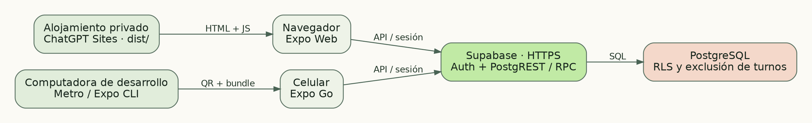
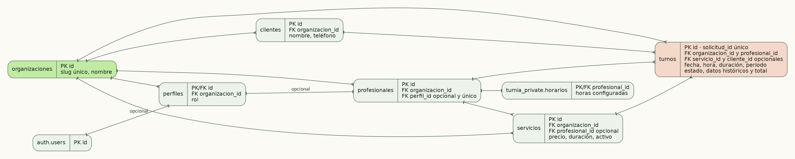

# 1. Introducción

## 1.1 Descripción general

Turnia organiza reservas de barbería. Una persona elige profesional, servicio, fecha y horario, carga su nombre y teléfono y obtiene un código de turno. El personal consulta su agenda y confirma o cancela solicitudes.

## 1.2 Propósito

Centralizar la disponibilidad y la atención para que una reserva creada desde un dispositivo llegue a la misma agenda que usa el profesional. El proyecto presenta una implementación funcional para la materia Aplicaciones Móviles.

## 1.3 Alcance

Incluye una web adaptable, ejecución con Expo Go, catálogo, turnos persistentes, agenda y gestión de servicios. La entrega utiliza Supabase Auth para el personal y permite reservar como cliente sin cuenta. La distribución móvil de esta entrega se hace mediante Expo Go. Los pagos, las notificaciones y la edición de horarios desde la interfaz quedan fuera de este alcance.

## 1.4 Objetivos de la documentación

Describir la arquitectura y el modelo de datos, registrar decisiones y pruebas verificables, y explicar cómo ejecutar, publicar y mantener Turnia.

# 2. Descripción del sistema

## 2.1 Objetivo del sistema

Ofrecer un recorrido de reserva sencillo y mantener una agenda compartida sin superposiciones para un mismo profesional.

## 2.2 Stakeholders

| Actor | Responsabilidad o interés |
|:--|:--|
| Cliente | Encontrar un horario, reservar y guardar su código. |
| Profesional | Ver y gestionar los turnos que le corresponden. |
| Administración | Gestionar la agenda de su organización y su catálogo de servicios. |
| Equipo de desarrollo | Mantener la app, las migraciones y la evidencia técnica. |
| Cátedra | Evaluar la implementación, la demostración y los entregables. |

## 2.3 Funciones principales

- **Cliente.** Consultar profesionales y servicios activos, elegir horario y prioridad VIP, validar datos y crear una solicitud pendiente.
- **Personal.** Acceder con correo y contraseña, consultar por fecha, ver el detalle, confirmar o cancelar.
- **Catálogo.** Crear, editar, pausar y reactivar servicios según el perfil. La administración gestiona los servicios de la organización. Un profesional gestiona los que tiene asignados.

## 2.4 Restricciones generales

El modo conectado requiere Internet y disponibilidad de Supabase. La web académica publicada es privada. Las reservas se consultan para siete fechas, incluida la fecha actual, en la zona horaria de Buenos Aires. Los precios visibles dependen del catálogo configurado.

# 3. Arquitectura del sistema

## 3.1 Estilo arquitectónico

La aplicación combina un cliente multiplataforma React Native con servicios administrados. Las pantallas comparten componentes y lógica en navegador y Expo Go. Supabase expone operaciones específicas mediante RPC y centraliza las reglas que deben respetar todos los dispositivos.

## 3.2 Componentes principales

| Componente | Función |
|:--|:--|
| React Native, Expo SDK 58 y Expo Router | Pantallas, navegación, diseño adaptable y sesión de usuario. |
| Estado y servicios del cliente | Selección del turno, datos del formulario, carga del catálogo y comunicación con Supabase. |
| Supabase Auth | Registro e inicio de sesión del personal, identificación mediante JWT. |
| API PostgREST y RPC de Turnia | Catálogo, disponibilidad, validación y persistencia, agenda, estados y servicios. |
| PostgreSQL | Entidades, integridad, políticas RLS y restricción de exclusión de turnos superpuestos. |

## 3.3 Diagrama de despliegue

{width=95%}

El servidor Metro se utiliza para la ejecución móvil de desarrollo. El navegador recibe HTML y JavaScript estáticos desde el alojamiento privado. Ambos clientes se conectan a Supabase por HTTPS con la clave pública y, para las operaciones del personal, con la sesión autenticada. [Web de Turnia](https://turnia-expo.independentbench4.chatgpt.site)

## 3.4 Escalabilidad y rendimiento

La distribución web estática separa la entrega de archivos del procesamiento de reservas. Las consultas de agenda utilizan organización, fecha y hora, y el catálogo tiene un índice por organización y profesional. La restricción GiST protege la agenda ante escrituras simultáneas. La entrega cuenta con comprobaciones funcionales. El rendimiento bajo carga y los objetivos en producción quedan por medir.

# 4. Diseño de datos

## 4.1 Diagrama Entidad-Relación

{width=100%}

## 4.2 Descripción de entidades

| Entidad | Claves y datos de negocio |
|:--|:--|
| `organizaciones` | UUID, nombre y slug único. Datos institucionales de contacto opcionales. |
| `auth.users` | Cuenta administrada por Supabase Auth. Un usuario puede tener un perfil Turnia. |
| `perfiles` | UUID igual al de Auth, organización, nombre, teléfono opcional y rol `admin` o `profesional`. |
| `profesionales` | UUID, organización, perfil opcional y único, nombre y estado activo. |
| `servicios` | UUID, organización, profesional opcional, nombre, descripción, duración, precio y estado activo. |
| `clientes` | UUID, organización, nombre y teléfono. Correo opcional. |
| `turnos` | UUID, organización, profesional, servicio y cliente opcionales, fecha, hora, VIP, estado y total. Conserva el nombre del servicio, nombre y teléfono del cliente, duración y código de solicitud cuando corresponde. |
| `turnia_private.horarios` | Configuración privada de horas por profesional. Una fila por profesional como máximo. |

La reserva anónima de Expo guarda el nombre y teléfono en el turno. El vínculo con `clientes` es opcional. El precio y la duración que se guardan en el turno preservan las condiciones aceptadas aunque después se edite el servicio.

## 4.3 Reglas de integridad

- La base verifica que el servicio y el profesional pertenezcan a la misma organización. Un servicio compartido puede reservarse con un profesional activo de esa organización.
- La disponibilidad excluye horarios pasados, fuera del rango de siete fechas, configuraciones inválidas y cruces con turnos pendientes o confirmados del mismo profesional.
- Una restricción GiST excluye intervalos superpuestos. Dos turnos pueden tocarse en el límite si uno termina cuando el otro empieza. Un turno cancelado deja de bloquear disponibilidad.
- El servidor calcula el total y el recargo VIP. Una diferencia con el precio mostrado obliga a revisar el servicio.
- El identificador único de solicitud permite reintentar la confirmación con los mismos datos y obtener el mismo turno.
- La edición directa del propio perfil permite nombre y teléfono. La gestión de la agenda se comprueba en el servidor por rol, organización y profesional.

## 4.4 Migración y respaldo

La migración `20261118233958_reservas_persistentes.sql` está registrada en Supabase. Conserva entidades y registros, completa la duración histórica con el servicio asociado o con 30 minutos si falta el vínculo y mantiene la función anterior de reserva. Antes de otra migración sobre datos existentes, ejecutar el diagnóstico, revisar superposiciones y confirmar el respaldo. La recuperación debe ensayarse en una instancia aislada con el mecanismo disponible en el plan contratado. No se registró un ensayo de restauración. [Migraciones y diagnóstico de la rama App](https://github.com/nicori25/Turnia/tree/App/supabase)

# 5. Comportamiento del sistema

## 5.1 Escenarios principales

| Escenario | Secuencia y resultado esperado |
|:--|:--|
| Solicitar turno | Elegir profesional, servicio, fecha y horario, ingresar datos y confirmar. Se obtiene un código y el estado Pendiente. |
| Confirmar en agenda | Acceder con el rol correspondiente, elegir fecha, abrir el turno y confirmar. El estado pasa a Confirmado. |
| Cancelar y liberar horario | Abrir un turno pendiente o confirmado y cancelar. El estado pasa a Cancelado y el horario reaparece si sigue vigente y libre. |
| Mantener un servicio | Abrir Servicios y crear, editar, pausar o reactivar. El catálogo refleja los servicios activos. |

## 5.2 Inicio de sesión

El cliente reserva sin cuenta. El personal entra con correo y contraseña por **Soy el barbero**. Si se exige verificación del correo, se completa según la configuración de Auth. El acceso privado al sitio con ChatGPT y el inicio de sesión de Turnia son dos controles distintos.

## 5.3 Validaciones

La interfaz verifica la selección y el formato del nombre y teléfono. El servidor valida nuevamente estos datos, la relación servicio-profesional, la duración, el precio y el horario. El control simultáneo se hace en la base para cubrir reservas de distintos dispositivos.

## 5.4 Manejo de errores

Si el horario se ocupa o el precio cambia, la pantalla solicita volver a la selección. Ante una falla de comunicación al guardar, el mismo formulario permite reintentar con los mismos datos. Para errores de carga, se ofrece una acción de reintento o actualización según la pantalla. Si la sesión no da acceso a un turno, la agenda no devuelve ese registro.

# 6. Restricciones del diseño

## 6.1 Compatibilidad

Web con navegador moderno y app con una versión de Expo Go compatible con SDK 58. La interfaz se adapta a distintos anchos. La evidencia móvil aportada por el equipo acredita el recorrido informado en dos dispositivos, con modelos y sistemas operativos sin consignar.

## 6.2 Rendimiento

Se consultan horarios por profesional, servicio y fecha, y la agenda por fecha o identificador. La selección anticipa cruces, mientras que PostgreSQL conserva la autoridad sobre la escritura. No hay una medición de latencia o concurrencia a escala incluida en la entrega.

## 6.3 Seguridad

HTTPS, sesión del personal con Supabase Auth, RLS y autorización por rol y organización en las RPC. El cliente usa una clave publicable. Las credenciales administrativas quedan fuera del cliente. El catálogo y la disponibilidad no devuelven teléfonos de clientes. Las advertencias de Supabase sobre funciones preexistentes y protección contra contraseñas filtradas requieren revisión antes de ampliar el acceso del despliegue.

## 6.4 Normativas aplicables

Para el contexto argentino, la Ley 25.326 sobre protección de datos personales es referencia para informar el tratamiento de nombres y teléfonos, limitar su uso a la gestión del turno y atender a los derechos de sus titulares. El proyecto documenta estos requisitos operativos. La presente entrega no es una certificación legal. [Texto actualizado de la Ley 25.326](https://www.argentina.gob.ar/normativa/nacional/ley-25326-64790/actualizacion)

## 6.5 Limitaciones tecnológicas

La operación conectada depende de la red, del servicio Supabase y de Expo Go en el entorno móvil académico. El catálogo muestra horarios por consulta y la agenda incluye actualización manual. La instalación de desarrollo requiere Node.js y acceso a las dependencias. El funcionamiento conectado está respaldado por la base remota. En el modo de demostración, los datos se restablecen al recargar.

# 7. Pruebas y validaciones

## 7.1 Pruebas unitarias

Se comprobaron la generación de fechas, el cálculo del recargo, la validación de nombre y teléfono y la disponibilidad de horarios. La lógica está en `src/domain/booking.js`. La integración vuelve a verificar las reglas críticas en el servidor.

## 7.2 Pruebas de integración

Las pruebas locales con Auth y PostgREST validaron concurrencia, reintento, actualización de estado, separación de organizaciones y permisos de profesionales. En Supabase real se verificó una reserva transaccional, su consulta desde agenda y la cancelación. La prueba se revirtió. [Pruebas del repositorio](https://github.com/nicori25/Turnia/tree/App/supabase/tests)

## 7.3 Pruebas de funcionalidades web

Se verificó en Chrome una reserva VIP contra una base de prueba. En el despliegue conectado se comprobaron también el catálogo y los horarios por la API. La exportación estática se volvió a compilar en la versión documentada. El recorrido de dos dispositivos se registra según lo confirmado por el usuario.

## 7.4 Pruebas del frontend

Se verificaron la exportación web y la lógica del recorrido de reserva y agenda. El alcance cubre carga del catálogo, selección, validación, confirmación, actualización de estado y tratamiento de errores. No se adjunta una matriz exhaustiva de navegadores ni capturas de dispositivos físicos.

## 7.5 Criterios de aceptación y evidencia

| ID | Criterio | Resultado y evidencia |
|:--|:--|:--|
| CA-01 | El catálogo y los horarios se recuperan desde Supabase. | Aprobado. Consultas públicas verificadas. |
| CA-02 | Se guarda una reserva y aparece con el mismo código en la agenda. | Aprobado. Prueba transaccional y recorrido en dos dispositivos confirmado por el usuario. |
| CA-03 | Una cancelación vuelve a liberar el horario. | Aprobado. Prueba de integración y verificación transaccional. |
| CA-04 | Dos solicitudes superpuestas para el mismo profesional no ocupan el intervalo simultáneamente. | Aprobado. Prueba concurrente local y restricción de exclusión en la base. |
| CA-05 | El personal administra turnos según su organización y rol. | Aprobado. Pruebas de acceso local y verificaciones de permisos. |
| CA-06 | La web se construye y el flujo de Expo Go se prueba en otro dispositivo. | Aprobado. Compilación verificada y prueba en dos dispositivos confirmada por el usuario. |

La confirmación del usuario se registró el 20 de noviembre de 2026 como evidencia declarada, según su indicación. No se aportaron capturas, modelo de dispositivo ni identificador de turno para ese registro.

# 8. Despliegue y operación

## 8.1 Entorno de desarrollo

Usar Node.js LTS compatible con Expo SDK 58, descargar la rama `App` y ejecutar `npm ci`. `npm start` inicia Metro y muestra el QR de Expo Go. `npm run web` inicia la versión de desarrollo en navegador. La rama incluye variables públicas. Para probar contra otra instancia, configurar `.env.local`. [Instrucciones del proyecto](https://github.com/nicori25/Turnia/tree/App)

## 8.2 Entorno de producción

El frontend se sirve como una exportación web estática en ChatGPT Sites, con acceso privado. Supabase aloja Auth y PostgreSQL. El endpoint público de Supabase recibe solicitudes del cliente y aplica sus permisos independientemente del acceso al sitio.

## 8.3 Publicación del sistema

Ejecutar `npm run build:web` y comprobar los HTML y recursos de `dist/`. El alojamiento debe servir las rutas de Expo Router, incluida `/admin/login`. Verificar el catálogo, iniciar sesión en la web y recorrer reservas contra el entorno correspondiente. Registrar la versión publicada y la versión anterior compatible. [Web privada de Turnia](https://turnia-expo.independentbench4.chatgpt.site)

## 8.4 Monitoreo

Consultar los registros de despliegue y Supabase cuando haya fallas. Comprobar por separado disponibilidad de la web, respuesta de la API, autenticación y operación afectada. Para una operación sostenida se propone registrar tasas de error y tiempos de respuesta. No se evidenciaron alertas automáticas configuradas.

## 8.5 Mantenimiento

Revisar dependencias, permisos, respaldo y resultado de pruebas antes de cada entrega. Conservar el artefacto web anterior para volver a desplegarlo si es compatible con el esquema. Una reversión web no cambia la base. Registrar por separado correcciones, migraciones y restauraciones, y evitar datos de clientes en la evidencia.

# 9. Ciclo de vida del software

## 9.1 Análisis de requisitos

Se tomó el prototipo de Turnia como punto de partida. Se priorizaron el uso en móvil y web, la disponibilidad compartida, la separación por organización, la continuidad de los registros existentes y la verificación de extremo a extremo.

## 9.2 Diseño

El trabajo avanzó de forma incremental. Se migraron las pantallas a Expo, se integró la persistencia, se adaptó el esquema a las organizaciones y profesionales existentes y se publicaron las reservas en la web privada. Después se validó el recorrido en dos dispositivos y se actualizó esta entrega documental. Las versiones y migraciones se conservan en `App`. [Historial de la rama App](https://github.com/nicori25/Turnia/commits/App/)
